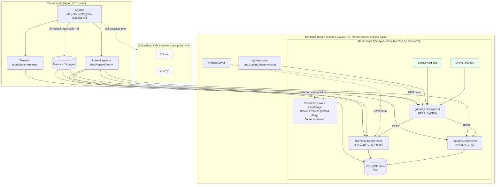

# FleetSync

**Containerized microservices deployment on Kubernetes, built with Docker, Minikube, Terraform and Ansible.**

FleetSync is a small fleet-management backend that runs as three containerized services
(gateway, registry, telemetry) plus Redis. The application is simple on purpose. The interesting
part is the infrastructure automation around it:

- **Docker**: multi-stage, non-root images with healthchecks, plus a `docker compose` stack for local development.
- **Kubernetes (Minikube)**: a multi-node cluster with the Calico CNI, built from plain manifests
  composed with **Kustomize**. There is **no Helm**. The cluster runs `dev` and `staging` overlays side by side.
- **Terraform**: provisions each isolated environment: namespace, ResourceQuota, LimitRange,
  default-deny NetworkPolicies, a generated Redis password Secret and an environment ConfigMap.
- **Ansible**: installs the toolchain on the control node and any lab VMs, starts Minikube, applies
  Terraform, builds images inside the cluster, rolls out workloads and smoke-tests them.
- **Horizontal Pod Autoscaling**: `autoscaling/v2` HPAs on CPU and memory, with tuned scale-up and
  scale-down behaviour. An in-cluster Locust load test pushes the telemetry service past its CPU
  target and checks that it scales out.
- **Testing**: pytest unit tests per service, an end-to-end functional suite against the live gateway,
  and Locust performance tests that record HPA behaviour.

## What the services do

| Service | Port | Responsibility |
|---------|------|----------------|
| `gateway` | 8080 | Public entrypoint. Proxies the vehicle API, checks that a vehicle is registered and not retired before accepting its telemetry, and builds a fleet overview from both backends. |
| `registry` | 8000 | Source of truth for vehicles: CRUD, depot/status filtering, and a status state machine (`idle`, `active`, `maintenance`, `retired`) that uses Redis optimistic locking. |
| `telemetry` | 8001 | Ingests position/speed/fuel/engine-temp readings, keeps a capped history per vehicle, computes summaries and alerts, and serves **route optimisation** (nearest-neighbour plus 2-opt). That endpoint is the CPU-bound workload that drives autoscaling. |
| `redis` | 6379 | StatefulSet with a PVC. Registry uses db 0 and telemetry uses db 1. |

Every service exposes `/healthz` (liveness), `/readyz` (dependency-aware readiness) and
`/metrics` (Prometheus request counters and latency histograms).

## Architecture



**Network policy model**: everything in a namespace is denied by default. The gateway accepts
traffic from anywhere. Registry and telemetry accept traffic only from the gateway, and Redis
accepts traffic only from registry and telemetry.

**What each layer owns**: Terraform owns the namespace-level infrastructure, including the Redis
password, which never appears in Git. Kustomize owns the workloads. Ansible runs both in the
right order.

## Repository layout

```
services/
  common/fleetsync_common/   shared JSON logging, Prometheus middleware, env settings
  registry/  telemetry/  gateway/
    app/                     FastAPI service
    tests/                   unit tests (fakeredis / mocked upstreams)
    Dockerfile               multi-stage, non-root (build context: services/)
k8s/
  base/                      Deployments, Services, Redis StatefulSet, HPAs, PDBs, Ingress
  overlays/dev|staging/      per-environment replicas, HPA bounds, resources, ingress host
terraform/
  modules/environment/       namespace, quota, limit range, network policies, secrets
  main.tf variables.tf ...   instantiates the module per environment
ansible/
  roles/                     prerequisites, minikube, images, terraform, deploy, verify, loadtest
  site.yml deploy.yml loadtest.yml teardown.yml
tests/
  functional/                end-to-end pytest suite against the gateway
  performance/locustfile.py  load profile (telemetry ingest + route optimisation)
scripts/                     hpa_watch.py, port_forward.sh
docker-compose.yml           local stack
Makefile                     shortcuts for everything below
```

## How to run

### Prerequisites

- Docker (Docker Desktop, colima or Docker Engine)
- Python 3.10+ and Ansible (`pip install ansible-core`)
- About 6 CPUs and 8 GB RAM free for the default two-node Minikube cluster. You can lower
  `minikube_nodes`, `minikube_cpus` and `minikube_memory_mb` in `ansible/group_vars/all.yml`.

The Ansible `prerequisites` role installs `kubectl`, `minikube` and `terraform`. It uses Homebrew
on macOS and direct downloads on Debian/Ubuntu.

### Option A: full Kubernetes deployment (recommended)

```bash
make bootstrap          # ansible-galaxy deps + ansible-playbook site.yml
```

This command:
1. installs the toolchain,
2. starts the `fleetsync` Minikube profile (2 nodes, Calico, metrics-server, ingress),
3. runs `terraform apply`, which creates the `fleetsync-dev` and `fleetsync-staging` namespaces
   with their quotas, policies and secrets,
4. builds the three images inside every Minikube node,
5. renders the Kustomize overlays (pinned to `IMAGE_TAG`), applies them and waits for rollouts,
6. runs an in-cluster smoke-test Job against each environment.

Then reach the API:

```bash
make port-forward ENV=dev                 # http://localhost:8080
curl localhost:8080/readyz
curl -X POST localhost:8080/api/vehicles -H 'content-type: application/json' \
     -d '{"id":"VAN-001","model":"Transit","depot":"north"}'
curl -X POST localhost:8080/api/vehicles/VAN-001/telemetry -H 'content-type: application/json' \
     -d '{"lat":40.71,"lon":-74.0,"speed_kph":48,"fuel_pct":72,"engine_temp_c":91}'
curl localhost:8080/api/fleet/overview
```

To use the Ingress instead, run `minikube -p fleetsync tunnel` (macOS) or use the node IP from
`minikube -p fleetsync ip` (Linux), and map `dev.fleetsync.local` to it in `/etc/hosts`.

Other lifecycle commands:

```bash
make deploy IMAGE_TAG=1.0.1     # rebuild + roll out a new tag
make kustomize-render ENV=staging
make tf-plan
make teardown                   # delete workloads + terraform destroy
make destroy                    # ...and delete the Minikube profile
```

To run only some phases, pass tags, for example `cd ansible && ansible-playbook site.yml --tags deploy,verify`.
To limit the run to one environment, use `-e '{"fleetsync_environments": ["dev"]}'`.

### Option B: local Docker Compose

```bash
make compose-up                 # gateway on http://localhost:8080
make compose-down
```

## How to test

### 1. Unit tests (no cluster needed)

```bash
make venv
make unit-test
```

Registry and telemetry tests run against `fakeredis`. Gateway tests use an `httpx.MockTransport`
that fakes both upstreams, including outages that should surface as 502 and 503 responses.
The route optimiser has its own property tests: every stop is visited exactly once, the result is
never worse than the input order, and collinear points come out in order.

### 2. Functional (end-to-end) tests

```bash
make port-forward ENV=dev &     # or: make compose-up
make functional-test            # FLEETSYNC_URL defaults to http://localhost:8080
```

This suite covers readiness across upstreams, the vehicle lifecycle and status state machine,
validation errors through the gateway, rejection of telemetry for unknown or retired vehicles,
history and summary maths, alerting, the fleet overview and route-optimisation quality.
Ansible's `verify` role also runs a curl-based smoke test inside each namespace on every deploy.

### 3. Performance tests and autoscaling validation

**In-cluster (recommended)**: Locust runs as a Job next to the gateway, so the load goes through
kube-proxy and not through a single port-forward.

```bash
make loadtest ENV=dev
# or: cd ansible && ansible-playbook loadtest.yml -e loadtest_env=staging -e loadtest_users=120
```

The role publishes the locustfile as a ConfigMap, starts `scripts/hpa_watch.py` in the background,
runs the Job, and then asserts two things: the load test completed, and the **telemetry HPA scaled
above `minReplicas`**. The Locust summary and an HPA time series (`results/hpa-<env>-<run>.csv`)
are written to `results/`.

**From your machine**: this run uses a stepped ramp of 10, 30 and 60 users, then cools down.

```bash
make port-forward ENV=dev &
make hpa-watch ENV=dev &        # samples HPA every 10s, fails if telemetry never scales out
make perf-test ENV=dev          # writes results/locust-dev*.csv and .html
```

You can also watch scaling live with `kubectl --context fleetsync -n fleetsync-dev get hpa -w`.

Load tunables are set through environment variables or Ansible vars: `FLEET_SIZE`, `ROUTE_STOPS`
(the size of each route-optimisation problem; more stops means more CPU), and `ROUTE_WEIGHT`.

## Design notes

- **No Helm.** Kustomize ships with `kubectl` and covers this project's needs: overlays,
  JSON6902 patches, config generators with hash suffixes (a config change triggers a rollout),
  and image pinning. The deploy role writes a small kustomization under `k8s/.generated/<env>`
  that layers the image tag on top of the committed overlay, so a deploy never edits tracked files.
- **Quotas are sized for the HPAs.** Each environment's ResourceQuota covers
  (`maxReplicas` + 1 surge pod) x per-pod requests and limits, plus Redis. Autoscaling can reach
  its ceiling, but one environment cannot starve another.
- **Scale-out actually spreads load.** kube-proxy balances per TCP connection, so the gateway
  expires pooled upstream connections after 5 seconds. Without that, the new telemetry pods would
  stay idle while the old ones stayed saturated.
- **Images are built inside the cluster.** `minikube image build --all` puts the images on every
  node, so no registry is needed and `imagePullPolicy: IfNotPresent` works wherever a pod lands.
